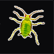
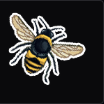
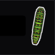
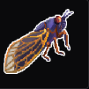
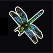
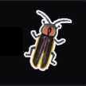
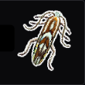
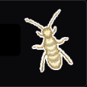
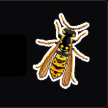

# Bugs
Grow-a-Tree had 40 collectible arthropods as of 22-11-2026. This guide currently lists 26.

**IMPORTANT:** This list is incomplete, as I am re-playing the game to collect data. 

Color can list one or more comma-separated values from red, orange, yellow, green, blue, indigo, violet, brown, and black. Provisional colors are estimates pending artwork verification.

Some data is based on this [Reddit](https://www.reddit.com/r/bored/comments/12bfe5f/grow_a_tree_discord_community_server/) thread.

---

## 8 :coin:

Each bug in this section is worth 8 :coin: and 40 experience points.

### Aphid

- page: 4
- Collected by: net
- Color: green

### Bee

- page: 0
- Collected by: net
- Color: yellow, black

### Caterpillar

- page: 0
- Collected by: net
- Color: green

### Cicada

- page: 4
- Collected by: net
- Color: orange, indigo

### Eastern Tent Caterpillar

- page: 4
- Collected by: net
- Color: yellow, green

### Hercules Beetle

- page: 2
- Collected by: net
- Color: orange, black

### Monarch Butterfly

- page: 2
- Collected by: net
- Color: orange, black

### Oak Treehopper

- page: 6
- Collected by: net
- Color: blue

## 16 :coin:

### Common Buckeye Butterfly

- page: 0
- Collected by: net
- Color: indigo, orange, yellow, black

### Cucumber Beetle

- page: 4
- Collected by: net
- Color: yellow, black

### Dragonfly

- page: 3
- Collected by: net
- Color: green, blue

### Firefly

- page: 1
- Collected by: net
- Color: orange, black

### Leafminer

- page: 5
- Collected by: net
- Color: orange

### Springtail

- page: 7
- Collected by: net
- Color: yellow

### Wasp

- page: 3
- Collected by: net
- Color: yellow, black

### Whitefly

- page: 4
- Collected by: net
- Color: yellow (provisional)

## 40 :coin:

### Bagworm Moth

- page: 4
- Collected by: net
- Color: orange, red, black

### Blue Dasher Dragonfly

- page: 0
- Collected by: net
- Color: blue

### Christmas Beetle

- page: 5
- Collected by: net
- Color: yellow

### Hummingbird Moth

- page: 5
- Collected by: net
- Color: orange

### Jewel Beetle

- Collected by: net
- Color: green (provisional)

### Orchard Orbweaver Spider

- page: 6
- Collected by: net
- Color: red, black, orange

### Spotted Lanternfly

- page: 7
- Collected by: net
- Color: red

### Walking Leaf

- page: 3
- Collected by: net
- Color: green

### Zebra Longwing Butterfly

- page: 6
- Collected by: net
- Color: yellow, black

## 80 :coin:

### Blue Morpho Butterfly

- page: 5
- Collected by: net
- Color: blue, black

